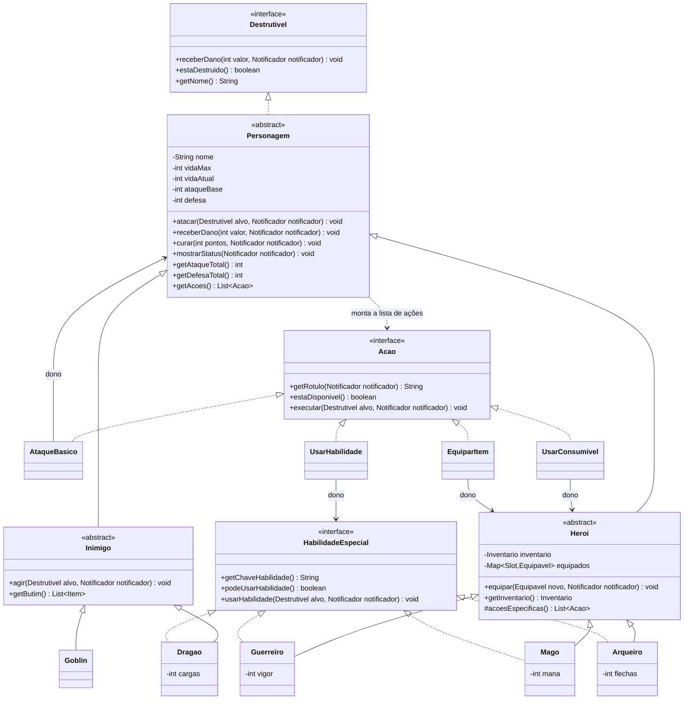
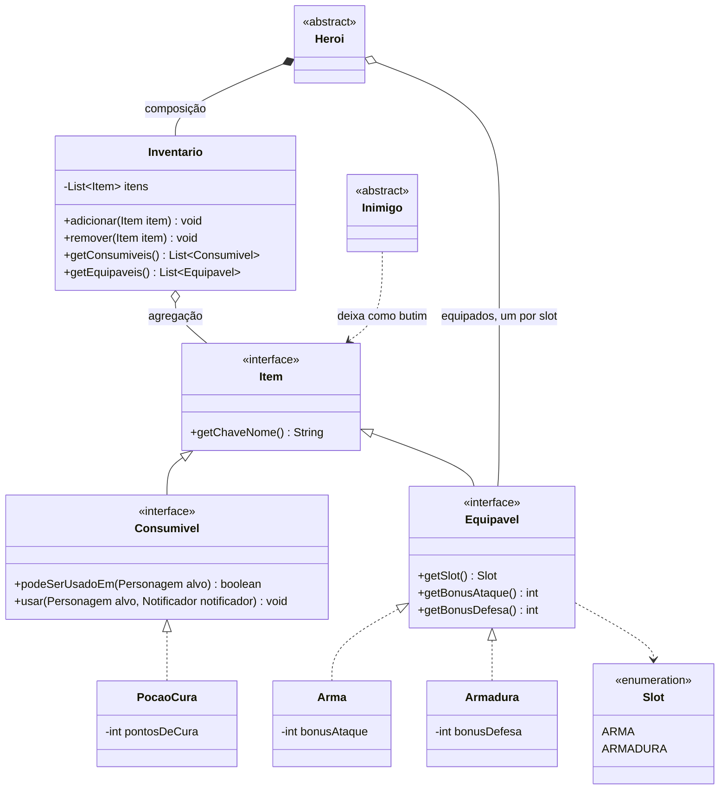
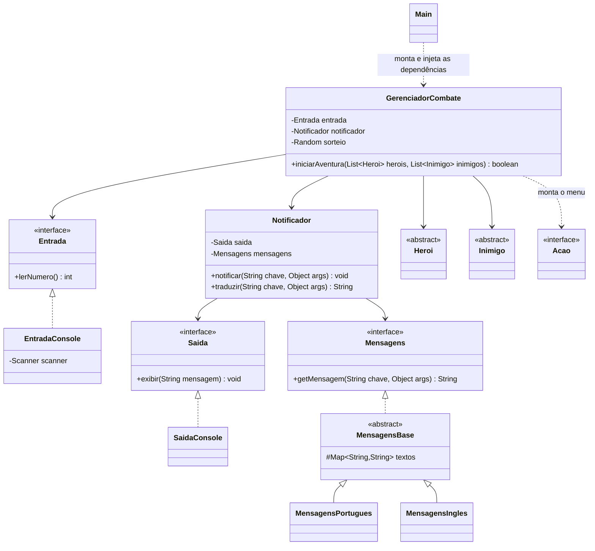
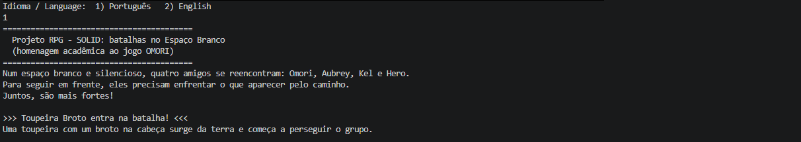
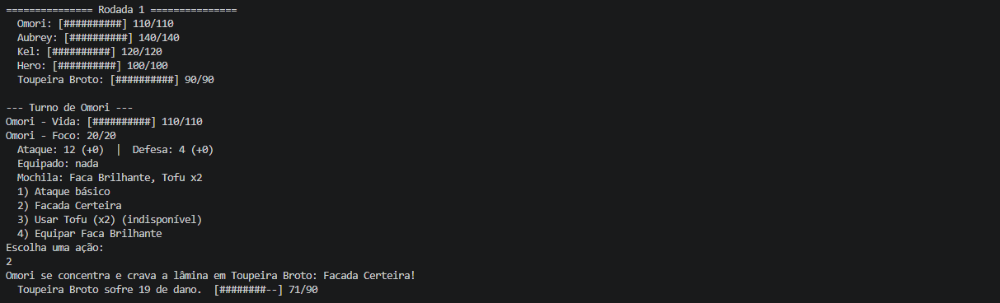
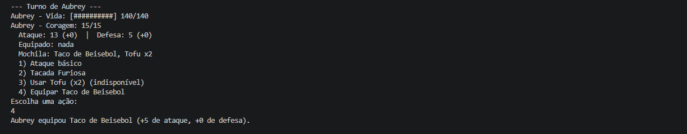
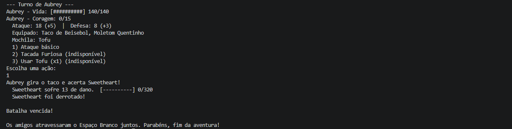

# Projeto RPG - SOLID

RPG de batalhas em turnos para o **console**, desenvolvido em **Java** para a disciplina de Paradigmas de Programação. O objetivo do projeto é aplicar **Programação Orientada a Objetos** e os cinco princípios **SOLID** em uma aplicação funcional.

**Autor:** Kauã Pires (trabalho individual)

## O jogo

Três heróis enfrentam, em sequência, um **Goblin** e o chefão **Smaug (Dragão)**. A cada turno, o jogador escolhe pelo terminal a ação de cada herói. O inimigo ataca um herói vivo, sorteado. Se todos os heróis caírem, é derrota; se os inimigos caírem, é vitória.

| Personagem | Vida | Ataque | Defesa | Habilidade especial | Recurso |
|---|---|---|---|---|---|
| Guerreiro (Aragorn) | 45 | 9 | 4 | Golpe Brutal | Vigor (15) |
| Mago (Luna) | 30 | 7 | 1 | Bola de Fogo | Mana (30) |
| Arqueiro (Legolas) | 35 | 8 | 2 | Chuva de Flechas (dois disparos) | Flechas (12) |
| Goblin | 25 | 6 | 1 | nenhuma | nenhum |
| Dragão (Smaug) | 80 | 14 | 3 | Sopro de Fogo | 3 cargas |

**Itens e inventário:** cada herói começa com 2 Poções de Cura, e o Aragorn leva uma Espada de Ferro (+4 de ataque). Equipamentos precisam ser equipados (gasta um turno). O Goblin deixa como butim uma Armadura de Couro (+2 de defesa). O jogo está disponível em **Português** e **English** (escolha no início).

## Como compilar e executar

**Requisito:** JDK 17 ou superior (`javac -version` para conferir).

```bash
git clone https://github.com/KauaQueirz/projeto-rpg-solid.git
cd projeto-rpg-solid
```

Compilar:

```bash
# Linux, macOS ou Git Bash
javac -encoding UTF-8 -d out $(find src -name "*.java")
```

```powershell
# Windows (PowerShell)
javac -encoding UTF-8 -d out (Get-ChildItem -Recurse -Filter *.java src).FullName
```

Executar:

```bash
java -cp out rpg.app.Main
```

> Se os acentos aparecerem estranhos no Windows, execute com `java -Dfile.encoding=UTF-8 -cp out rpg.app.Main`.

**Como jogar:** no início, digite `1` (Português) ou `2` (English). Em cada turno, digite o número da ação desejada e aperte Enter. Ações sem recurso aparecem como "indisponível".

## Estrutura do projeto

```
projeto-rpg-solid/
├── src/rpg/
│   ├── app/            # Main (ponto de entrada e montagem das dependências)
│   ├── domain/
│   │   ├── contract/   # Destrutivel, HabilidadeEspecial
│   │   ├── model/      # Personagem, Heroi, Guerreiro, Mago, Arqueiro, Inimigo, Goblin, Dragao
│   │   ├── acao/       # Acao, AtaqueBasico, UsarHabilidade, UsarConsumivel, EquiparItem
│   │   ├── item/       # Item, Consumivel, Equipavel, Slot, PocaoCura, Arma, Armadura, Inventario
│   │   └── event/      # Notificador
│   ├── i18n/           # Mensagens, MensagensBase, MensagensPortugues, MensagensIngles
│   ├── presentation/   # Entrada, EntradaConsole, Saida, SaidaConsole
│   └── service/        # GerenciadorCombate
├── docs/               # Diagramas de classes
├── screenshots/        # Capturas de tela da execução
└── README.md
```

## Conceitos de POO aplicados

- **Abstração:** `Personagem`, `Heroi` e `Inimigo` são classes abstratas; `Destrutivel`, `Acao`, `Item` e outras são interfaces.
- **Encapsulamento:** os atributos são `private`. A vida só muda por `receberDano()` e `curar()`, que garantem as regras (nunca abaixo de 0 nem acima do máximo).
- **Herança:** `Guerreiro`, `Mago` e `Arqueiro` herdam de `Heroi`; `Goblin` e `Dragao` herdam de `Inimigo`; ambos herdam de `Personagem`.
- **Polimorfismo:** o combate trata todos como `Personagem`/`Heroi`/`Inimigo`. Cada classe responde de seu jeito a `getAcoes()`, `usarHabilidade()` e `agir()`.
- **Composição e agregação:** o `Heroi` possui seu `Inventario` (composição); o `Inventario` guarda `Item`s que existem de forma independente, como o butim deixado por um inimigo (agregação).

## Diagramas de classes

Os diagramas estão em [Mermaid](https://mermaid.js.org/), que o GitHub renderiza automaticamente. A mesma versão está em [`docs/diagrama-classes.md`](docs/diagrama-classes.md). Também há versões em imagem: [diagrama 1](docs/diagrama-1-personagens.png), [diagrama 2](docs/diagrama-2-itens.png) e [diagrama 3](docs/diagrama-3-combate.png).

### Diagrama 1: personagens, habilidades e ações



### Diagrama 2: itens, inventário e equipamentos



### Diagrama 3: combate, entrada/saída e idiomas



## Princípios SOLID: onde e como foram aplicados

### S: Responsabilidade Única (Single Responsibility)

Cada classe tem um único motivo para mudar:

- `SaidaConsole` é a **única** classe que conhece o `System.out`, e `EntradaConsole` é a única que conhece o `Scanner`.
- `Personagem` e suas subclasses cuidam apenas das regras (vida, dano, habilidades). Elas **não imprimem nada**: apenas avisam o `Notificador` (`notificador.notificar("damage_received", ...)`).
- `Notificador` apenas liga o domínio à tela: pega o texto no idioma certo (`Mensagens`) e envia para a `Saida`.
- `GerenciadorCombate` cuida só da ordem dos turnos.
- `Inventario` cuida só de guardar itens.

### O: Aberto/Fechado (Open/Closed)

Dá para **estender** sem **modificar** o que já existe:

- `Goblin` e `Dragao` foram adicionados como novas subclasses de `Inimigo`, sem alterar nenhuma classe existente.
- O menu do jogador é montado a partir de `heroi.getAcoes()`. As ações `UsarConsumivel` e `EquiparItem` entraram no jogo sem que o `turnoDoHeroi` precisasse conhecê-las: basta implementar `Acao`.
- Um novo idioma é uma nova subclasse de `MensagensBase` (como `MensagensIngles`), sem mexer no código do jogo.
- Um novo item é uma nova classe que implementa `Consumivel` ou `Equipavel` (por exemplo, uma `PocaoMana`).

### L: Substituição de Liskov (Liskov Substitution)

- O `GerenciadorCombate` usa qualquer `Heroi` e qualquer `Inimigo` sem saber qual é o tipo concreto: `Guerreiro`, `Mago` e `Arqueiro` entram na mesma lista e funcionam igual.
- `Inimigo.agir()` funciona para `Goblin` e para `Dragao`, mesmo que só um deles tenha habilidade especial.
- `Heroi` sobrescreve `getAtaqueTotal()` e `getDefesaTotal()` apenas **somando** os bônus de equipamentos, sem quebrar o contrato da classe base.
- Nenhuma subclasse lança exceção por "não saber fazer" algo herdado: quem não tem habilidade não herda esse método (veja ISP).

### I: Segregação de Interfaces (Interface Segregation)

As interfaces são pequenas e específicas:

- `HabilidadeEspecial` é implementada **somente** por quem tem habilidade (`Guerreiro`, `Mago`, `Arqueiro` e `Dragao`). O `Goblin` não é obrigado a ter métodos vazios.
- `Consumivel` e `Equipavel` são separadas: uma poção não precisa saber de bônus de ataque, e uma espada não precisa saber "ser usada".
- `Entrada` e `Saida` são contratos distintos: quem só exibe texto não precisa saber ler.
- `Destrutivel` contém apenas o que um alvo precisa oferecer, e por isso um baú ou portão poderia ser atacado do mesmo jeito.

### D: Inversão de Dependência (Dependency Inversion)

- O `GerenciadorCombate` depende de abstrações (`Entrada`, `Notificador`, `Heroi`, `Inimigo`, `Acao`, `Item`) e **nunca** de `Goblin`, `Mago`, `Scanner` ou `System.out`.
- O `Notificador` recebe uma `Saida` e uma `Mensagens` (interfaces) **pelo construtor**. Trocar o console por outra tela, ou o português por outro idioma, não exige alterar o domínio.
- `Personagem.atacar()` recebe um `Destrutivel`, e não um `Personagem`.
- A classe `Main` é a **única** que escolhe as implementações concretas (`SaidaConsole`, `EntradaConsole`, `MensagensPortugues`, `Goblin`...) e as injeta nas demais.

## Capturas de tela

**Escolha de idioma e início da batalha**



**Menu de ações e combate em turnos**



**Equipando um item e usando uma habilidade**



**Vitória sobre o Dragão**


