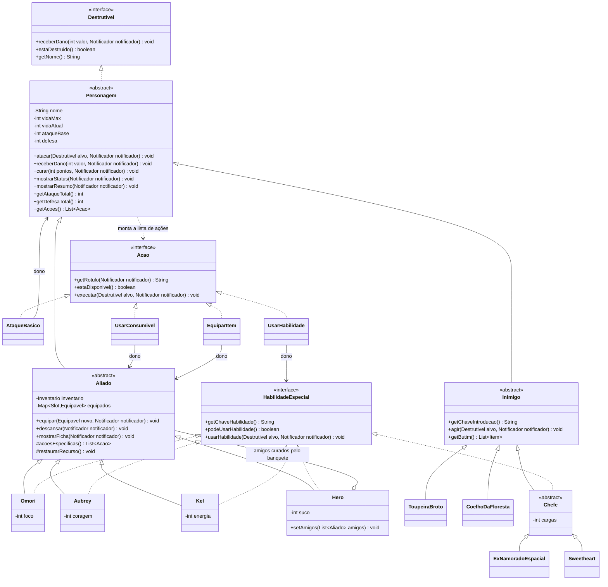
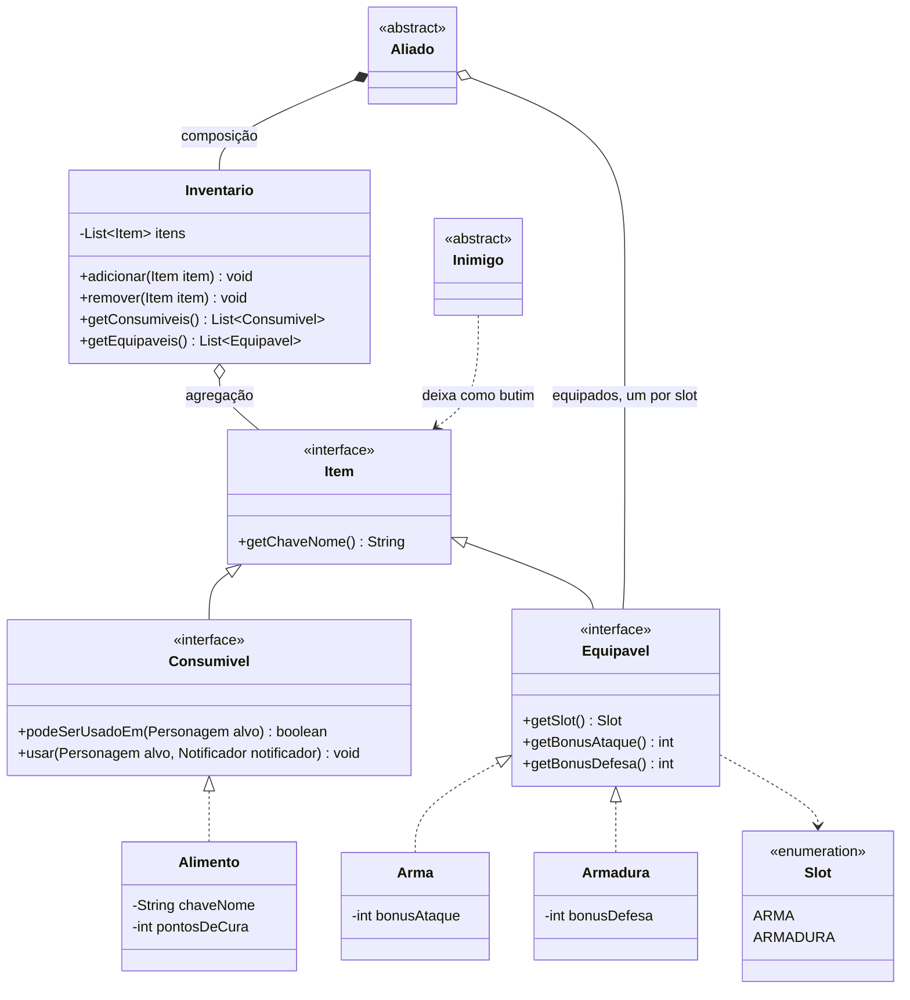
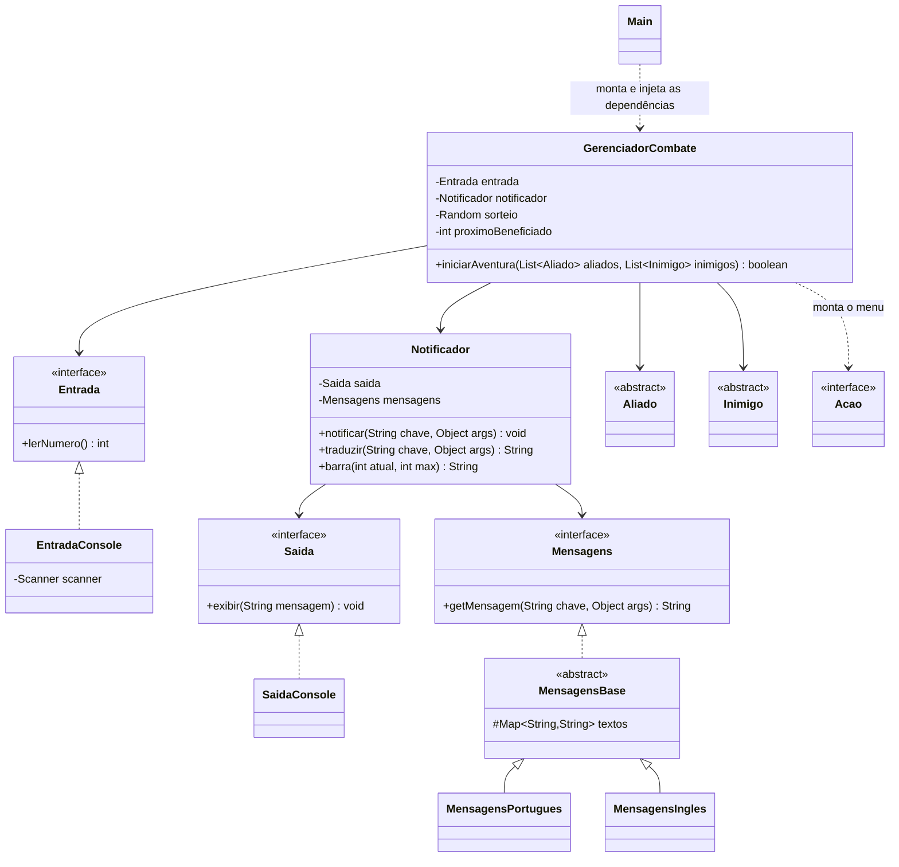

# Projeto RPG - SOLID

RPG de batalhas em turnos para o **console**, desenvolvido em **Java** para a disciplina de Paradigmas de Programação, com tema inspirado no jogo **OMORI**. O objetivo do projeto é aplicar **Programação Orientada a Objetos** e os cinco princípios **SOLID** em uma aplicação funcional.

**Autor:** Kauã Pires (trabalho individual)

> **Aviso:** OMORI é uma obra de OMOCAT. Este é um projeto acadêmico, sem fins lucrativos, que usa apenas nomes de personagens e de elementos como homenagem. Nenhum texto, imagem ou música do jogo original foi copiado; todos os textos foram escritos para este trabalho.

## Como o projeto foi construído

O projeto nasceu como um **RPG de fantasia genérico**, criado para praticar POO e SOLID: um Guerreiro, um Mago e um Arqueiro enfrentavam um Goblin e um Dragão chefão, com poções de cura e equipamentos. Foi essa primeira versão que definiu toda a arquitetura: interfaces pequenas, dependências injetadas pelo construtor, textos separados da lógica e um menu de ações montado dinamicamente.

Com a base funcionando, o tema foi **trocado para o universo de OMORI**:

| Versão genérica | Versão OMORI |
|---|---|
| Guerreiro | Aubrey |
| Arqueiro | Kel |
| Mago | Hero (agora um personagem de apoio, que cura o grupo) |
| (novo) | Omori, que entrou como mais um amigo |
| Goblin | Toupeira Broto e Coelho da Floresta |
| Dragão (chefão) | Ex-Namorado Espacial e Sweetheart (chefes) |
| Poção de Cura | Tofu, Doce e Geleia da Vida |

Junto com o tema, a aventura ficou mais longa e mais informativa: passou a ter quatro amigos e quatro batalhas, descanso entre elas, ficha completa a cada turno e narração mais detalhada.

A troca exigiu poucas mudanças porque a arquitetura segue o SOLID: o motor de combate não conhece personagens concretos e os textos ficam isolados nas classes de mensagens. Foi um exemplo prático do **OCP** (estender sem modificar) e do **DIP** (depender de abstrações).

## O jogo

Quatro amigos (**Omori, Aubrey, Kel e Hero**) atravessam o Espaço Branco enfrentando quatro batalhas em sequência: **Toupeira Broto**, **Coelho da Floresta**, **Ex-Namorado Espacial** e a chefe final, **Sweetheart**. A cada turno, o jogador escolhe pelo terminal a ação de cada amigo; depois o inimigo ataca um amigo vivo, sorteado. Se todos caírem, é derrota; se vencerem as quatro batalhas, é vitória.

**Os amigos**

| Personagem | Vida | Ataque | Defesa | Habilidade especial | Recurso |
|---|---|---|---|---|---|
| Omori | 110 | 12 | 4 | Facada Certeira (+9 de dano) | Foco (20, custo 6) |
| Aubrey | 140 | 13 | 5 | Tacada Furiosa (+10 de dano) | Coragem (15, custo 5) |
| Kel | 120 | 11 | 3 | Chuva de Bolas (dois arremessos, +4 cada) | Energia (18, custo 3) |
| Hero | 100 | 8 | 3 | Banquete de Panquecas (cura 30 de vida de todos os amigos feridos) | Suco (25, custo 8) |

**Os inimigos**

| Inimigo | Vida | Ataque | Defesa | Habilidade | Butim |
|---|---|---|---|---|---|
| Toupeira Broto | 90 | 24 | 2 | nenhuma | Tofu |
| Coelho da Floresta | 130 | 32 | 3 | nenhuma | Moletom Quentinho |
| Ex-Namorado Espacial (chefe) | 220 | 44 | 4 | Raio Espacial (3 cargas, +16) | Geleia da Vida |
| Sweetheart (chefe final) | 320 | 52 | 5 | Grito Doce (4 cargas, +18) | nenhum |

**Itens**

- **Consumíveis:** Tofu (cura 35), Doce (cura 70) e Geleia da Vida (cura 150). Só podem ser usados por quem está ferido.
- **Equipamentos:** Faca Brilhante (+6 de ataque, começa com o Omori), Taco de Beisebol (+5 de ataque, começa com a Aubrey) e Moletom Quentinho (+3 de defesa, vem como butim). Equipar gasta o turno, e o equipamento antigo volta para a mochila.
- **Início:** cada amigo começa com 2 Tofus, e o Hero também leva um Doce.

**Durante o turno**, o jogo mostra a ficha do amigo da vez: barra de vida, recurso, ataque e defesa já com os bônus dos equipamentos, itens equipados e mochila. Cada ataque, habilidade e derrota é narrado em texto. **Entre as batalhas**, os amigos descansam: recuperam parte da vida e do recurso, e quem desmaiou se levanta. O jogo está disponível em **Português** e **English** (escolha no início).

## Como compilar e executar

**Requisito:** JDK 17 ou superior (`javac -version` para conferir).

```bash
git clone https://github.com/KauaQueirz/projeto-rpg-solid.git
cd projeto-rpg-solid
```

Compilar:

```bash
# Linux, macOS ou Git Bash
javac -encoding UTF-8 -d out $(find src -name "*.java")
```

```powershell
# Windows (PowerShell)
javac -encoding UTF-8 -d out (Get-ChildItem -Recurse -Filter *.java src).FullName
```

Executar:

```bash
java -cp out rpg.app.Main
```

> Se os acentos aparecerem estranhos no Windows, execute com `java -Dfile.encoding=UTF-8 -cp out rpg.app.Main`.

**Como jogar:** no início, digite `1` (Português) ou `2` (English). Em cada turno, digite o número da ação desejada e aperte Enter. Ações sem recurso (ou itens sem utilidade no momento) aparecem como "indisponível". Uma partida completa leva cerca de 50 escolhas.

## Estrutura do projeto

```
projeto-rpg-solid/
├── src/rpg/
│   ├── app/            # Main (ponto de entrada e montagem das dependências)
│   ├── domain/
│   │   ├── contract/   # Destrutivel, HabilidadeEspecial
│   │   ├── model/      # Personagem, Aliado, Omori, Aubrey, Kel, Hero,
│   │   │               # Inimigo, ToupeiraBroto, CoelhoDaFloresta, Chefe, ExNamoradoEspacial, Sweetheart
│   │   ├── acao/       # Acao, AtaqueBasico, UsarHabilidade, UsarConsumivel, EquiparItem
│   │   ├── item/       # Item, Consumivel, Equipavel, Slot, Alimento, Arma, Armadura, Inventario
│   │   └── event/      # Notificador
│   ├── i18n/           # Mensagens, MensagensBase, MensagensPortugues, MensagensIngles
│   ├── presentation/   # Entrada, EntradaConsole, Saida, SaidaConsole
│   └── service/        # GerenciadorCombate
├── docs/               # Diagramas de classes
├── screenshots/        # Capturas de tela da execução
└── README.md
```

## Conceitos de POO aplicados

- **Abstração:** `Personagem`, `Aliado`, `Inimigo` e `Chefe` são classes abstratas; `Destrutivel`, `Acao`, `Item` e outras são interfaces.
- **Encapsulamento:** os atributos são `private`. A vida só muda por `receberDano()` e `curar()`, que garantem as regras (nunca abaixo de 0 nem acima do máximo).
- **Herança:** `Omori`, `Aubrey`, `Kel` e `Hero` herdam de `Aliado`; `ToupeiraBroto`, `CoelhoDaFloresta` e `Chefe` herdam de `Inimigo`; `ExNamoradoEspacial` e `Sweetheart` herdam de `Chefe`; todos herdam de `Personagem`.
- **Polimorfismo:** o combate trata todos como `Aliado` ou `Inimigo`. Cada classe responde de seu jeito a `getAcoes()`, `usarHabilidade()`, `agir()` e a como narra seus ataques (`getChaveAtaque()`).
- **Composição e agregação:** o `Aliado` possui seu `Inventario` (composição); o `Inventario` guarda `Item`s que existem de forma independente, como o butim deixado por um inimigo (agregação). O `Hero` também mantém referências aos amigos que cura (agregação).

## Diagramas de classes

Os diagramas estão em [Mermaid](https://mermaid.js.org/), que o GitHub renderiza automaticamente. A mesma versão está em [`docs/diagrama-classes.md`](docs/diagrama-classes.md). Também há versões em imagem: [diagrama 1](docs/diagrama-1-personagens.png), [diagrama 2](docs/diagrama-2-itens.png) e [diagrama 3](docs/diagrama-3-combate.png).

### Diagrama 1: personagens, habilidades e ações



### Diagrama 2: itens, inventário e equipamentos



### Diagrama 3: combate, entrada/saída e idiomas



## Princípios SOLID: onde e como foram aplicados

### S: Responsabilidade Única (Single Responsibility)

Cada classe tem um único motivo para mudar:

- `SaidaConsole` é a **única** classe que conhece o `System.out`, e `EntradaConsole` é a única que conhece o `Scanner`.
- `Personagem` e suas subclasses cuidam apenas das regras (vida, dano, habilidades). Elas **não imprimem nada**: apenas avisam o `Notificador` (`notificador.notificar("damage_received", ...)`).
- `Notificador` apenas liga o domínio à tela: pega o texto no idioma certo (`Mensagens`), monta a barra de vida e envia para a `Saida`.
- `GerenciadorCombate` cuida só da ordem dos turnos, do descanso e da divisão do butim.
- `Inventario` cuida só de guardar itens, e `Aliado` só de equipar e descrever o que carrega.

### O: Aberto/Fechado (Open/Closed)

Dá para **estender** sem **modificar** o que já existe:

- Os quatro amigos e os quatro inimigos são subclasses de `Aliado` e `Inimigo`. O `Hero`, com uma mecânica própria (cura em grupo), entrou no jogo sem alterar o `GerenciadorCombate`.
- O menu do jogador é montado a partir de `aliado.getAcoes()`. As ações `UsarConsumivel` e `EquiparItem` entram no jogo sem que o `turnoDoAliado` precise conhecê-las: basta implementar `Acao`.
- `Chefe` concentra a lógica de habilidade com cargas; `ExNamoradoEspacial` e `Sweetheart` só informam números e textos.
- Um novo idioma é uma nova subclasse de `MensagensBase` (como `MensagensIngles`), sem mexer no código do jogo.
- Um novo item é uma nova classe que implementa `Consumivel` ou `Equipavel`; novos alimentos (Tofu, Doce, Geleia da Vida) são apenas objetos `Alimento` com valores diferentes.

### L: Substituição de Liskov (Liskov Substitution)

- O `GerenciadorCombate` usa qualquer `Aliado` e qualquer `Inimigo` sem saber o tipo concreto: `Omori`, `Aubrey`, `Kel` e `Hero` entram na mesma lista e funcionam igual.
- `Inimigo.agir()` funciona para `ToupeiraBroto` (sem habilidade) e para os `Chefe`s (com habilidade).
- `Aliado` sobrescreve `getAtaqueTotal()` e `getDefesaTotal()` apenas **somando** os bônus de equipamentos, sem quebrar o contrato da classe base.
- Nenhuma subclasse lança exceção por "não saber fazer" algo herdado: quem não tem habilidade não herda esse método (veja ISP).

### I: Segregação de Interfaces (Interface Segregation)

As interfaces são pequenas e específicas:

- `HabilidadeEspecial` é implementada **somente** por quem tem habilidade (os quatro amigos e `Chefe`). `ToupeiraBroto` e `CoelhoDaFloresta` não são obrigados a ter métodos vazios.
- `Consumivel` e `Equipavel` são separadas: um alimento não precisa saber de bônus de ataque, e uma faca não precisa saber "ser comida".
- `Entrada` e `Saida` são contratos distintos: quem só exibe texto não precisa saber ler.
- `Destrutivel` contém apenas o que um alvo precisa oferecer, e por isso um baú ou portão poderia ser atacado do mesmo jeito.

### D: Inversão de Dependência (Dependency Inversion)

- O `GerenciadorCombate` depende de abstrações (`Entrada`, `Notificador`, `Aliado`, `Inimigo`, `Acao`, `Item`) e **nunca** de `Omori`, `ToupeiraBroto`, `Scanner` ou `System.out`.
- O `Notificador` recebe uma `Saida` e uma `Mensagens` (interfaces) **pelo construtor**. Trocar o console por outra tela, ou o português por outro idioma, não exige alterar o domínio.
- `Personagem.atacar()` recebe um `Destrutivel`, e não um `Personagem`.
- A classe `Main` é a **única** que escolhe as implementações concretas (`SaidaConsole`, `EntradaConsole`, `MensagensPortugues`, `Omori`, `ToupeiraBroto`...) e as injeta nas demais.

## Capturas de tela

As imagens abaixo foram feitas com o jogo rodando no terminal, na versão em português.

**1. Início do jogo:** escolha do idioma (Português ou English), prólogo da história e apresentação da primeira batalha, contra a Toupeira Broto.


**2. Combate em turnos:** a ficha do amigo da vez mostra a barra de vida, o recurso da personagem, o ataque e a defesa (já com os bônus dos equipamentos), o que está equipado e a mochila. Abaixo dela fica o menu numerado de ações.


**3. Equipamentos e habilidades:** um item sendo equipado e uma habilidade especial sendo usada, com a narração do que aconteceu e a vida do alvo sendo atualizada.


**4. Vitória:** mensagem final depois de derrotar a Sweetheart, a última chefe.


