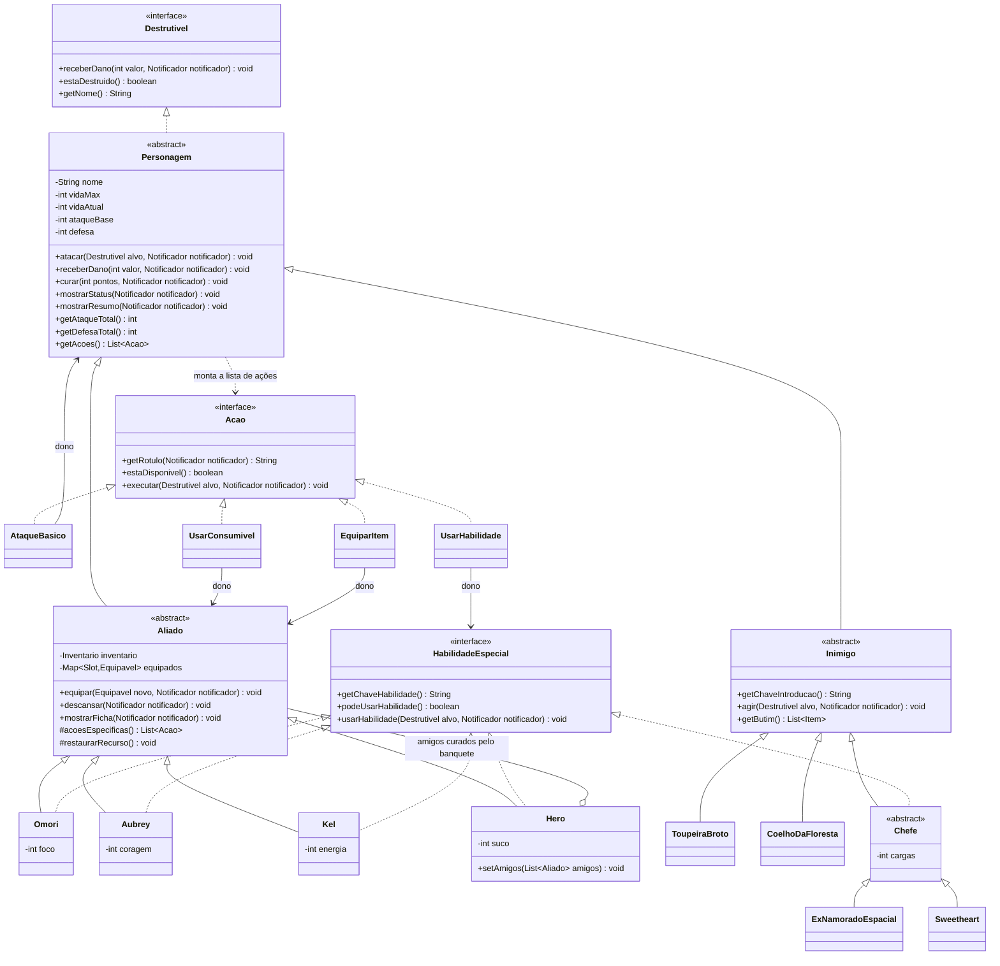
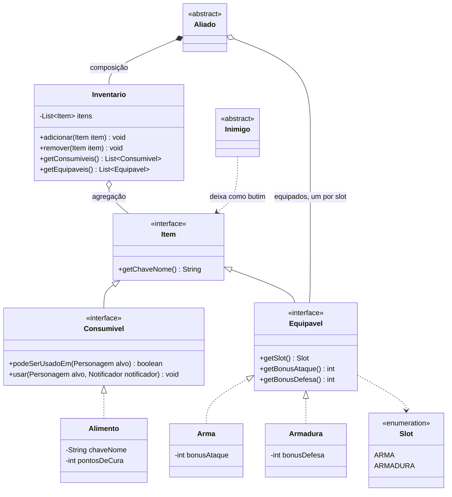
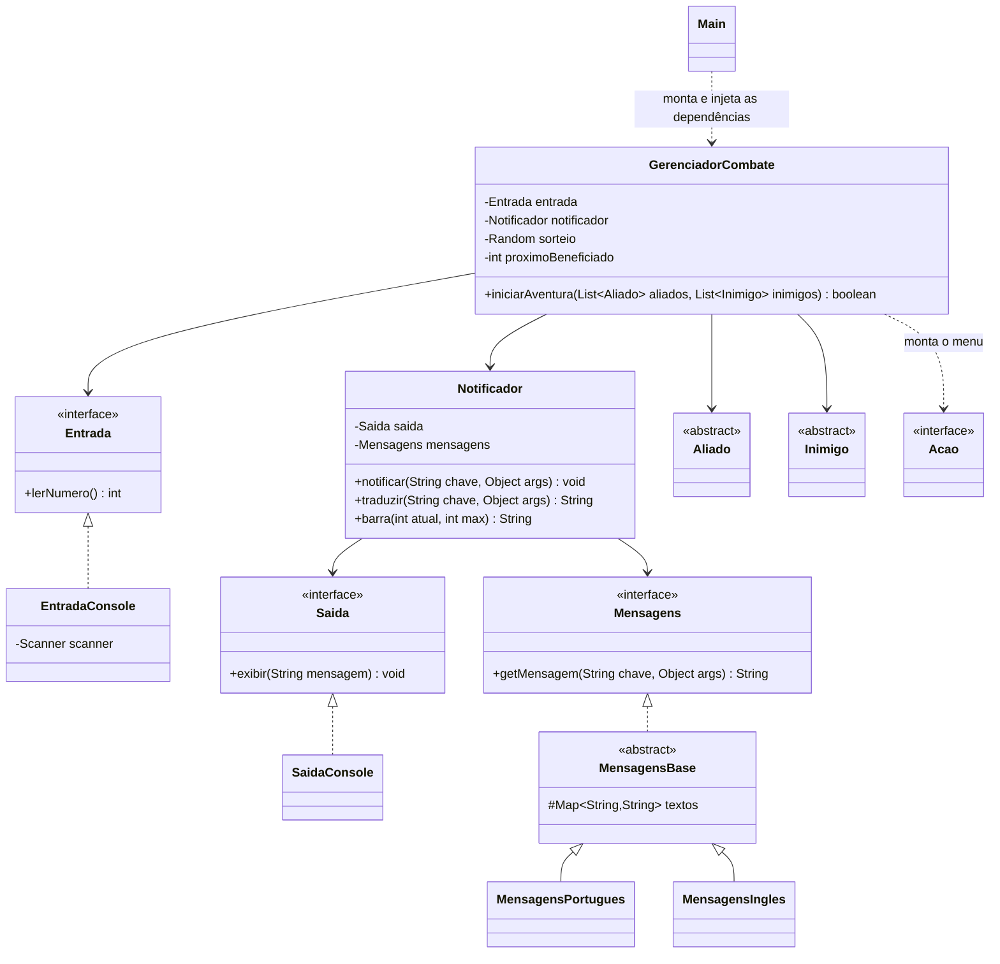

# Diagramas de classes - Projeto RPG - SOLID

Código Mermaid (renderizado automaticamente pelo GitHub). Imagens PNG nesta mesma pasta: diagrama-1-personagens.png, diagrama-2-itens.png e diagrama-3-combate.png.

### Diagrama 1: personagens, habilidades e ações

### Diagrama 2: itens, inventário e equipamentos

### Diagrama 3: combate, entrada/saída e idiomas

